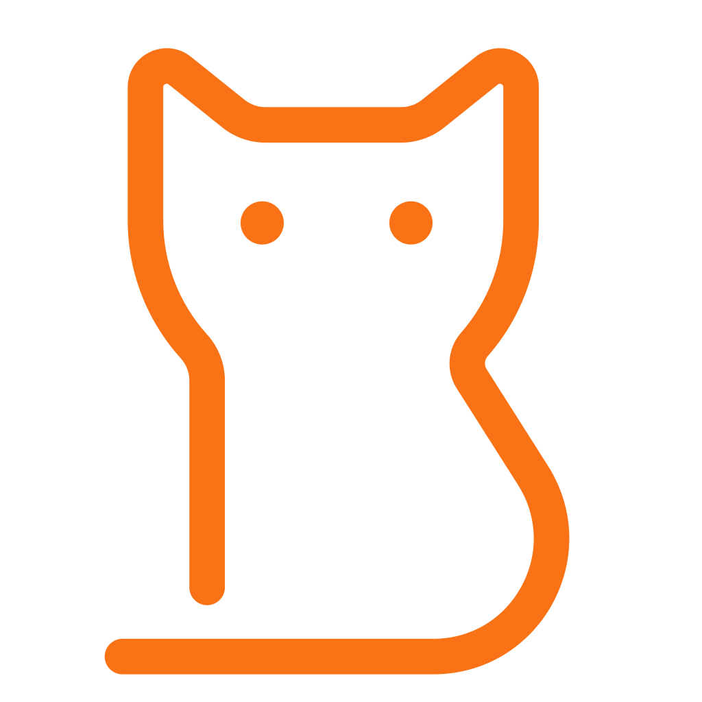

<p align="center">
 
</p>

# LomoCat 的猫窝

<p align="center">
 
 
 
 
 
 
 
</p>

**LomoCat 的猫窝** —— 我的个人博客。

使用 Next.js 15 (App Router) + React 19 + TypeScript 构建，SQLite 存储数据，Tailwind CSS 4 设计样式，部署在阿里云上。

博客地址：[lomocat.xyz](https://lomocat.xyz)

## 功能特色

- **项目首页** — 展示个人项目、技术栈与功能，搭配博主和朋友们拍摄的猫片
- **Markdown 写作** — 用 frontmatter + Markdown 写文章，支持代码高亮、表格、GFM 语法
- **亮暗模式** — 主题切换，CSS 变量驱动
- **交互背景** — SVG 图样、鼠标点云、滚动视差和轻量点击反馈，支持减少动态效果
- **音乐播放器** — 可拖动的浮动按钮，带展开、收起动画，支持循环与随机播放
- **评论区** — 支持嵌套回复、验证码、频率限制
- **今天吃什么** — 按偏好抽取餐食，自动搭配品牌饮品，带先快后慢的翻牌动画和粒子效果
- **友链名片** — 动态读取站名、简介和链接，支持悬浮光感、轻微倾斜和手机布局
- **访问统计** — 趋势图、热门页面、来源分析

## 技术栈

| 层 | 技术 |
|---|---|
| 框架 | Next.js 15 (App Router, SSG/ISR) |
| UI | React 19 + Tailwind CSS 4 |
| 语言 | TypeScript 5.7 |
| 数据库 | SQLite (better-sqlite3) |
| 内容 | Markdown (gray-matter + react-markdown) |
| 部署 | Alibaba Cloud ECS |
| SSL | Let's Encrypt |

## 项目结构

```
my-blog/
├── src/
│   ├── app/                    # App Router 页面与 API 路由
│   ├── components/             # 共享组件
│   ├── lib/                    # 工具库
│   ├── content/posts/          # Markdown 文章源文件
│   └── locales/                # i18n 翻译文件
├── public/
├── data/
│   └── blog.db                 # SQLite 数据库文件
├── scripts/
├── nginx.conf
└── blog.service
```

## 快速开始

### 环境要求
- Linux（当前依赖包含 Linux 版 FFmpeg）
- Node.js 22+
- npm

### 本地开发

```bash
git clone git@github.com:LoMoCatAp/my-blog.git
cd my-blog
npm ci
cp .env.example .env.local
# 编辑 .env.local，设置自己的 BLOG_ADMIN_PASSWORD
npm run init-db
npm run dev
```

访问 `http://localhost:3000`。

### 构建与启动

```bash
npm run build
npm start
```

## 部署

```bash
# 重启博客服务
sudo systemctl restart blog

# 查看日志
journalctl -u blog -f
```

## 文章

在 `src/content/posts/` 下创建 `.md` 文件：

```markdown
---
title: "文章标题"
date: "2026-06-20"
tags: ["标签1", "标签2"]
description: "文章摘要"
published: true
---

正文 Markdown 内容...
```

## 当前限制

- Markdown 文章更新需重新构建；友链、菜单和后台配置从数据库读取。
- 仓库不包含线上数据库、后台密码、评论或访客记录；菜单、友链及音乐列表等运行数据需自行配置，或从自己的备份恢复。
- 音乐上传目录不再接收新的 Git 提交，仓库已有的音频文件保留。

## 作者

- **洛陌（Lomo）** — [lomocat.xyz](https://lomocat.xyz)
- GitHub: [@LoMoCatAp](https://github.com/LoMoCatAp)
